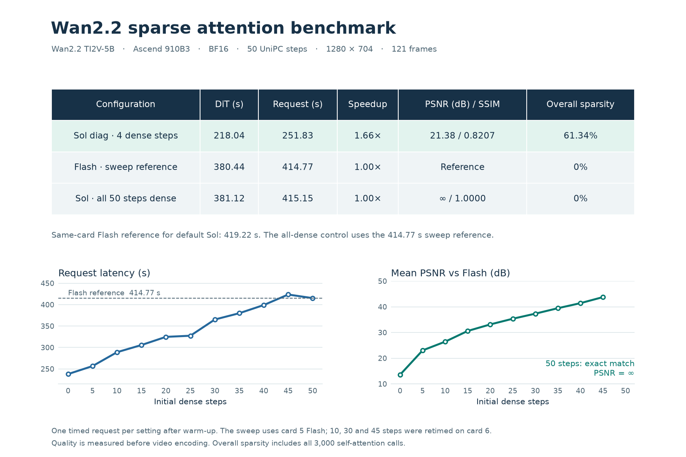
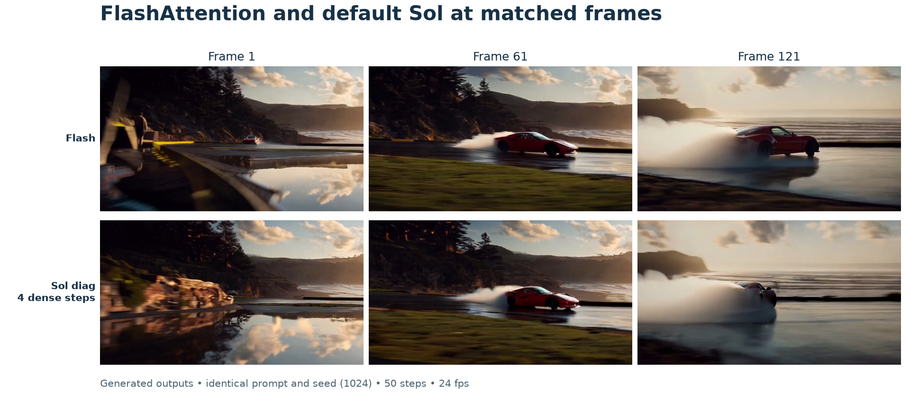
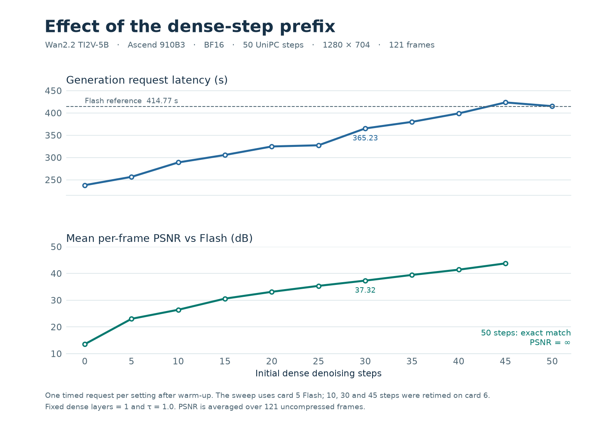

# Wan2.2 TI2V-5B on Ascend 910B3

## Default Sol and full dense fallback

| Configuration and purpose | DiT (s) | Request (s) | Request speedup | PSNR / SSIM | Overall sparsity |
| --- | ---: | ---: | ---: | ---: | ---: |
| [Sol diag, first 4 steps dense](videos/sol-default-4.mp4) — default speed and quality | 218.04 | 251.83 | 1.66× | 21.38 dB / 0.8207 | 61.34% |
| [Flash](videos/flash-sweep.mp4) — dense reference for the sweep | 380.44 | 414.77 | 1.00× | Reference | 0% |
| [Sol, all 50 steps dense](videos/sol-50.mp4) — verify fallback overhead and output equality | 381.12 | 415.15 | 1.00× | ∞ / 1.0000 | 0% |

The default used its [same-card Flash reference](videos/flash-default-run.mp4) of **419.22 s**. The fallback used the sweep reference of **414.77 s** and matched all uncompressed RGB values. The default benchmark ran on a shared host and NPU. [Default pair and routing results](default-sol.json)

## Generated output comparison

Both rows use the same prompt and seed (1024). The top row shows FlashAttention and the bottom row shows Sol diag with four initial dense steps. Frames are numbered from one and sampled from the archived MP4s. The quality metrics above use the uncompressed outputs. [Synchronized comparison video (Flash left, Sol right)](../dense-vs-diag.mp4)

## Dense-prefix ablation

The 11 configurations vary only the dense step prefix, with one dense layer, tau 1.0, 50 UniPC steps, 1280 × 704, 121 frames, 24 fps, CFG 5, flow shift 5 and seed 1024. Each timing covers one measured request after warm-up. Timing and routing used separate processes. The sweep uses a single Flash reference on card 5 for both speed and quality. Cases ran on cards 5 and 6.

| Dense prefix | DiT (s) | Request (s) | Launch to MP4 (s) | Request speedup | PSNR (dB) | SSIM | Sol calls | Within Sol | All calls |
| ---: | ---: | ---: | ---: | ---: | ---: | ---: | ---: | ---: | ---: |
| [0](videos/sol-00.mp4) | 203.72 | 237.92 | 343.23 | 1.74× | 13.55 | 0.6392 | 2900 | 69.78% | 67.45% |
| [5](videos/sol-05.mp4) | 222.63 | 256.56 | 363.69 | 1.62× | 23.03 | 0.8365 | 2610 | 68.97% | 60.00% |
| [10](videos/sol-10.mp4) | 255.12 | 288.92 | 413.49 | 1.44× | 26.42 | 0.9022 | 2320 | 68.92% | 53.30% |
| [15](videos/sol-15.mp4) | 271.47 | 305.68 | 417.58 | 1.36× | 30.58 | 0.9479 | 2030 | 68.91% | 46.63% |
| [20](videos/sol-20.mp4) | 290.06 | 324.74 | 435.00 | 1.28× | 33.13 | 0.9671 | 1740 | 68.92% | 39.97% |
| [25](videos/sol-25.mp4) | 292.85 | 327.37 | 434.58 | 1.27× | 35.35 | 0.9761 | 1450 | 68.92% | 33.31% |
| [30](videos/sol-30.mp4) | 331.32 | 365.23 | 477.91 | 1.14× | 37.32 | 0.9822 | 1160 | 68.91% | 26.64% |
| [35](videos/sol-35.mp4) | 346.41 | 379.95 | 490.35 | 1.09× | 39.44 | 0.9866 | 870 | 68.88% | 19.98% |
| [40](videos/sol-40.mp4) | 365.00 | 398.96 | 522.32 | 1.04× | 41.40 | 0.9899 | 580 | 68.85% | 13.31% |
| [45](videos/sol-45.mp4) | 389.00 | 423.55 | 547.35 | 0.98× | 43.76 | 0.9930 | 290 | 68.80% | 6.65% |
| [50](videos/sol-50.mp4) | 381.12 | 415.15 | 518.86 | 1.00× | ∞ | 1.0000 | 0 | N/A | 0.00% |

The CSV includes both physical card identifiers, Sol and Flash call counts, and both sparsity denominators. Sparsity counts query/key block pairs served by the pooled approximation. Overall sparsity includes all 3,000 self-attention calls. A run with zero Sol calls has no within-Sol denominator. PSNR and SSIM are means over pre-MP4 FP32 RGB frames. The JSON includes weight loading, text encoding, DiT, denoising loop, VAE decode, request, MP4 export, and launch-through-export timings. These intervals overlap.

## Retest and provenance

The original timing runs at 10, 30 and 45 dense steps had samples with other NPU processes. Those three timings and quality measurements were repeated on physical card 6. Across the three accepted repeats, none of the 185 occupancy samples observed another process. Each repeat matched the original uncompressed output hash. Routing counts and sparsity come from the original independent routing runs. The 10- and 45-step measurements also changed physical cards.

- [Full-precision CSV](results.csv) and [final stage timings, quality, hashes and routing](summary.json)
- [Original sweep](original-sweep.json), [before/after comparison](retest-comparison.json), and [timestamped NPU occupancy samples](occupancy.jsonl)
- [Package versions and weight configuration hashes](environment.json) and [latency–PSNR trade-off plot](dense-steps-latency-psnr.png)
- [Generated videos](videos/) and [SHA-256 checksums](SHA256SUMS)
- [Focused unit and offline tests](../morton-move-tests.log) and [default benchmark logs](../morton-50step/)
